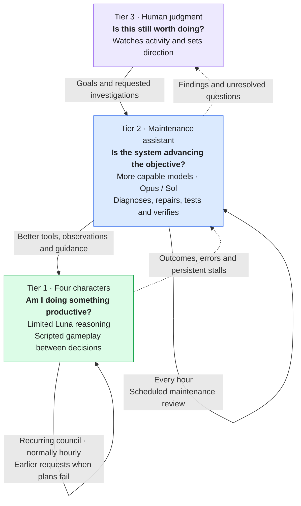

# Runescape Rascals: I Accidentally Built a Company

**Engineering lightning talk · approximately 6–7 minutes**
**Draft: November 8, 2026**

Speaker text is written out below. Visual suggestions and evidence notes are separate from the spoken script.

## 1. Four adventurers and a small budget

**Visual:** A RuneScape screenshot showing a mine, followed by portraits of the party.

I watched [Max Bittker’s talk about RS-SDK and RuneBench](https://www.youtube.com/watch?v=cNm4zyUtWj0), and immediately wanted to try something in this space.

If you haven’t played RuneScape: it’s a persistent online game where you mine, fish, craft equipment, fight monsters and improve skills. Think of a world full of small engineering dependencies. Making a sword requires more than deciding you’d like a sword.

Max’s project exposes that world to AI agents through an SDK. I wanted to see whether four characters could live there, make progress together and be interesting to watch—without spending much on routine reasoning.

So I made Runescape Rascals: Bram, Wren, Mike and Trish.

I thought I was building a party of adventurers. Eventually, it started looking suspiciously like a company.

## 2. Tier 1: cheap decisions, scripted work

**Visual:** Reveal the bottom tier of the diagram. Show one example routine beside it.

The characters use a cheap model, GPT-6 Luna, to decide what to do next.

They don’t ask a model how to click every rock. They choose routines from a limited action set: travel, mine, fish, smelt, smith, bank, give items and fight.

For example:

```text
Withdraw ore → smelt a batch → make equipment → bank it
```

Code does most of the repetitive work: checking ingredients, moving around, handling inventory space and running the actions.

The model comes back when work finishes, something fails, a relevant message arrives or the plan changes. The party also has a recurring council to coordinate its work.

Their basic question is: **“Am I doing something productive?”**

That turned out to be a surprisingly incomplete question.

## 3. Tier 2, then tier 3

**Visual:** Reveal the maintenance tier, then the human tier. Show the recurring loops and upward feedback arrows.

Above the characters is a more capable coding assistant, using models such as Opus or Sol across maintenance sessions.

It can read the implementation, inspect logs, reproduce problems, change the harness and run tests. An hourly review checks how the party is doing. I can also ask it to investigate something specific.

Its question is: **“Is this work advancing the shared objective—and does the system support doing that?”**

Then there’s me. I watch the dashboard and ask things like: Why are these high-level characters still fighting cows? Why is everyone busy while the mission hasn’t moved?

My question is: **“Is this objective still worth pursuing?”**

So we have cheap reasoning close to the work, broader reasoning reviewing the system, and a human deciding whether the result is interesting.

The corrections flow down. The evidence—and sometimes the complaints—flows up.

### Diagram



**Speaker note:** Regular councils are hourly in the inspected code; routine decisions are event-driven. Errors enter logs and character recovery first, rather than every error automatically launching a maintenance session. Maintenance also runs when the human requests it.

## 4. They developed shared knowledge about dangerous roads

**Visual:** A map with two routes to a bank. Label observed successful trips, damage and deaths; avoid presenting either route as guaranteed safe.

One of my favorite examples was travel.

Walking somewhere could get a character attacked and killed. We added a route ledger: code recorded whether trips succeeded, caused significant damage, failed or ended in death.

Then the characters started using that history.

They compared the western bank route with the eastern route. They distinguished a trip in one direction from a trip in the other. They warned each other about prior losses, and Wren explicitly chose the eastern route after discussing its successful trips.

We built the notebook. What was interesting was watching them use it as shared practical knowledge.

It was a small version of something familiar: “Don’t take that road. We’ve had problems there. Try this one.”

**Evidence note:** October 20 reflections compare route histories; Wren subsequently chose the eastern route and completed travel. Exact success ratios in reflections are character claims, not independently established safety probabilities. The claim that someone recently killed was deliberately selected as an expendable scout is not established here; omit it unless separately verified.

## 5. The same channels spread stale beliefs

**Visual:** A small timeline: stranded → transport repaired → back on mainland → old explanation still repeated.

But shared memory had a downside.

Wren got stuck on a ship at Karamja. The party developed an explanation that her position made the mission inaccessible.

We fixed the transport code. She climbed out, took the ferry and banked her fish on the mainland.

The party still repeated versions of the old explanation.

The same channels that spread useful route knowledge could preserve a conclusion after its cause was gone.

That was a useful lesson: **remembering something isn’t the same as keeping it true.**

**Evidence note:** The November 7–8 recovery verified the fare, mainland position and banking. Subsequent conversations retained blocked-access explanations. “Rumor” is a presentation analogy, not evidence of intentional misinformation.

## 6. Goodhart’s law, with pickaxes

**Visual:** Put rising XP or resource totals beside unchanged shared-mission milestones. Use records from the same time window.

The other striking behavior was that they could all be productive while the team failed to make progress.

The smith made equipment. Someone else fished. Someone chopped trees. XP went up, banks filled and the dashboard looked healthy.

But the shared objective barely moved.

Each character had a reasonable explanation: “My dependency is blocked, so I’m doing useful fallback work.” Four reasonable local decisions added up to an unresolved collective problem.

This is where Goodhart’s law becomes a useful lens: **when we optimize an easy-to-measure proxy, it can stop representing what we actually wanted.**

XP was easy to see. Interesting teamwork was harder to measure.

We tried shared exploration missions. Everyone contributed—but then they repeated the same regions. They got good at completing our checklist. We hadn’t necessarily made them curious.

**Four productive workers can still make an unproductive team.**

**Evidence note:** This is an interpretation of observed proxy mismatch, not a controlled demonstration of deliberate reward gaming. The earlier audit found 48 regional mission selections with their required checks completed; that did not establish 48 novel discoveries.

## 7. The dashboard—and the organization chart

**Visual:** Open [the dashboard](https://tylerbarron.com/runescape-rascals). Keep a screenshot or short recording ready as a fallback.

Here’s the party. You can see their activity, their equipment, their conversations and their mission progress.

The important thing is to look at those together. “Running,” “busy” and “making progress toward the goal” are different states.

At some point, I realized what I’d built.

The characters have a recurring coordination meeting. That’s a standup.

There’s a layer reviewing their tools, resolving blockers and asking why the work isn’t advancing. That’s starting to sound like management.

And I’m looking at the whole thing asking whether we should be doing any of it.

Apparently, I’m the CEO.

I set out to automate a RuneScape party, and accidentally recreated an organization—including meetings, stale institutional knowledge and impressive activity metrics.

## 8. Closing question

**Visual:** Four portraits and one question.

The interesting challenge stopped being whether they could eventually reach level 99.

It became whether they could learn useful things, share them, revise them and do something worthwhile together—with less intervention from me over time.

**What would you ask four agents to do together that you couldn’t measure with an XP counter?**

---

## Preparation and references

- For a strict five-minute slot, shorten the architecture explanation and show one failure story. Keep the route story and Goodhart example.
- Capture dashboard activity and mission progress from the same time window. Do not imply the paired-combat challenge succeeded unless new game evidence verifies it.
- Model pricing ratios are intentionally omitted. Character planning costs exclude maintenance models, hosting and human time; date any spending figure shown.
- Personalities and relationship backstories were seeded. Present subsequent choices and interactions as the interesting behavior, rather than claiming those backstories emerged spontaneously.
- [Full retrospective and evidence appendix](runescape-rascals-retrospective.md).
- [Layer responsibilities](../agents/LAYERS.md), [route recording](../agents/routes.ts), [dated operational evidence](../agents/HANDOFF.md).
- Inspiration: [Max Bittker’s talk](https://www.youtube.com/watch?v=cNm4zyUtWj0), [RS-SDK](https://github.com/MaxBittker/rs-sdk/), [RuneBench](https://maxbittker.github.io/runebench/), and LostCity. The talk references use the supplied description; this script does not claim a full transcript review.
